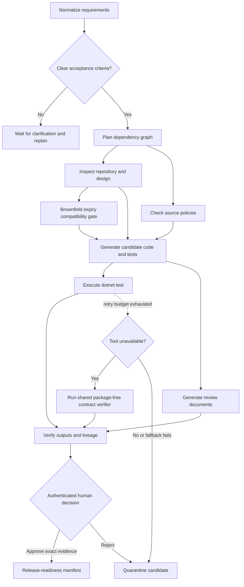

# Agentic URL Shortener

A runnable .NET 8 URL shortener and governed engineering workflow. Given a requirement within its supported feature vocabulary, the workflow inspects maintained source, generates an isolated candidate application and tests, runs `dotnet test`, assembles review evidence, and pauses for a separate authenticated reviewer. Approval produces a release-readiness manifest; it does not deploy.

The generator uses trusted templates and deterministic requirement rules. It supports analytics, expiration, and HTTPS-only target policies. It does not call an LLM or implement arbitrary natural-language feature requests. See [engineering summary](docs/ENGINEERING_SUMMARY.md) for assumptions and limits.

## Setup and tests

Prerequisites: .NET 8 **SDK**, Git, and Python 3 for the reproducible HTTP demo. NuGet access is needed for the initial test-package restore. No database, cloud account, or LLM API key is required.

```bash
# If the SDK was installed in your user directory:
export PATH="$HOME/.dotnet:$PATH"

dotnet test tests/AgenticUrlShortener.Tests/AgenticUrlShortener.Tests.csproj
# Opt into demonstration fault injection; omit the variable to disable it.
ENABLE_FAILURE_INJECTION=true dotnet run --project src/AgenticUrlShortener --urls http://localhost:5080
```

Open http://localhost:5080/docs. The full API contract is at http://localhost:5080/openapi.json. Keep the service on loopback: it can build and execute trusted generated applications under your OS account.

On first start, the service creates distinct random operator and reviewer keys in `src/AgenticUrlShortener/data/access-keys.json` (owner-only permissions on Unix). It does not print keys. The operator creates/replans work; the reviewer approves/rejects it. Management reads require either key. Redirects, service information, docs, and the API schema are public.

Alternatively set distinct `OPERATOR_API_KEY` and `REVIEWER_API_KEY` environment variables together. Credentials identify two local roles, not enterprise users. Use TLS and an identity provider for any remote deployment.

## Reproduce the complete demonstration

In a second terminal:

```bash
python3 scripts/verify_workflow.py --failure-demos --output /tmp/agentic-workflow-evidence.json
```

This executes URL creation/redirect/analytics/disable, actual candidate generation and testing, approval and role checks, brownfield replanning with a changed graph, clarification, rejection, persistent-failure safe-stop, fallback, and metrics. It reads the key file without printing credentials. For a server started without fault injection, omit `--failure-demos`.

## Manual workflow commands

Load the local keys into shell variables:

```bash
export OPERATOR_API_KEY="$(python3 -c 'import json; print(json.load(open("src/AgenticUrlShortener/data/access-keys.json"))["operator"])')"
export REVIEWER_API_KEY="$(python3 -c 'import json; print(json.load(open("src/AgenticUrlShortener/data/access-keys.json"))["reviewer"])')"
```

Create and inspect a candidate (the request waits for its tools to finish):

```bash
curl -X POST http://localhost:5080/api/workflows \
  -H "X-Api-Key: $OPERATOR_API_KEY" -H 'Content-Type: application/json' \
  -d '{"requirement":"Build HTTPS-only links with expiration and click analytics","scenario":"greenfield","simulateTestFailure":true}'

# Replace YOUR_ID with the response id.
curl -H "X-Api-Key: $REVIEWER_API_KEY" http://localhost:5080/api/workflows/YOUR_ID
curl -H "X-Api-Key: $REVIEWER_API_KEY" http://localhost:5080/api/workflows/YOUR_ID/audit
curl -H "X-Api-Key: $REVIEWER_API_KEY" http://localhost:5080/api/workflows/YOUR_ID/artifacts/REVIEW.md
curl -H "X-Api-Key: $REVIEWER_API_KEY" http://localhost:5080/api/workflows/YOUR_ID/artifacts/app/FeaturePolicy.cs
```

Expect `WaitingApproval`, a pending release node, one retry, two test attempts, real TRX test evidence, and a `reviewDigest`. After inspecting the generated source and results, copy the current `revision` and `reviewDigest` into the decision:

```bash
curl -X POST http://localhost:5080/api/workflows/YOUR_ID/approval \
  -H "X-Api-Key: $REVIEWER_API_KEY" -H 'Content-Type: application/json' \
  -d '{"approved":true,"revision":1,"evidenceHash":"COPY_CURRENT_REVIEW_DIGEST","reason":"Reviewed generated source, passing tests, and risks"}'
```

The actor comes from the credential. Operator approval returns 403; changed/stale evidence returns 409 or safely stops the workflow. A passing decision completes release readiness and writes `RELEASE.json`. Set `approved` to `false` to reject and quarantine the candidate.

Replan before completion, including clarification of an ambiguous requirement:

```bash
curl -X POST http://localhost:5080/api/workflows/YOUR_ID/replan \
  -H "X-Api-Key: $OPERATOR_API_KEY" -H 'Content-Type: application/json' \
  -d '{"requirement":"Add expiration and click analytics","revision":1}'
curl -H "X-Api-Key: $OPERATOR_API_KEY" http://localhost:5080/api/workflows/metrics
```

Replanning preserves prior evidence in `history`, quarantines the old candidate, increments revision, recomputes the graph, clears demonstration faults, and requires fresh approval. Completed workflows are immutable. “Make links secure” pauses at `WaitingClarification`; “Require HTTPS-only links and analytics” provides supported acceptance criteria.

## URL API

```bash
curl -X POST http://localhost:5080/api/urls \
  -H "X-Api-Key: $OPERATOR_API_KEY" -H 'Content-Type: application/json' \
  -d '{"url":"https://example.com","expiresInDays":30}'
curl -i http://localhost:5080/YOUR_CODE
curl -H "X-Api-Key: $OPERATOR_API_KEY" http://localhost:5080/api/urls/YOUR_CODE/analytics
curl -X DELETE -H "X-Api-Key: $OPERATOR_API_KEY" http://localhost:5080/api/urls/YOUR_CODE
```

## Execution graph and artifacts



The compatibility node exists only for brownfield expiration changes. Other paths join design and security directly. State is under `src/AgenticUrlShortener/data/`; each candidate lives in `workspaces/{id}/r{revision}/` with `app/`, `tests/`, `checks/`, `verifier/`, `results/`, `requirements.json`, `api.json`, and `REVIEW.md`. The maintained repository is never patched automatically.

To run an approved candidate locally:

```bash
cd src/AgenticUrlShortener/data/workspaces/YOUR_ID/r1
dotnet run --project app/Candidate.csproj --urls http://localhost:5081
```

The generated application's own schema is at http://localhost:5081/openapi.json. It is an unauthenticated local review artifact, not a production deployment.

## Failure controls and configuration

| Setting/input | Behavior |
| --- | --- |
| `DATA_DIR` | Override the local state, keys, journal, and workspace directory |
| `REPOSITORY_ROOT` | Locate trusted source/templates when running outside the checkout |
| `DOTNET_EXECUTABLE` | Override the SDK executable; defaults to `dotnet` |
| `ENABLE_FAILURE_INJECTION=true` | Permit explicit demonstration faults; disabled by default |
| `simulateTestFailure:true` | Fail the first test-stage attempt, then execute real tests on retry |
| `failureMode:"persistent-tests"` | Exhaust three attempts; quarantine and safe-stop |
| `failureMode:"runner-unavailable"` | Exhaust primary retries, then run the same three contract checks through a package-free console verifier |

Real failing tests never use fallback. Tool runs have a 120-second timeout, bounded captured output, fixed argument lists, and no shell. API credentials are excluded from the child environment. At most two new workflows and one compiler/test process per stage-executor instance run concurrently. Interrupted work safely stops on restart; an explicit replan is required.

## Documentation and submission

- [Architecture and governance](docs/ARCHITECTURE.md)
- [Three scenarios](docs/SCENARIOS.md)
- [Engineering summary and limitations](docs/ENGINEERING_SUMMARY.md)
- [Executed validation results](docs/VALIDATION.md)

GitHub Actions runs the suite, the full HTTP demonstration, and a regression check that generated data and credentials stay out of controller build/publish output.

Repository: https://github.com/navsoftechsolutions-afk/agentic-url-shortener

The repository shares source and reproduction instructions. Public hosting is not part of this prototype.
