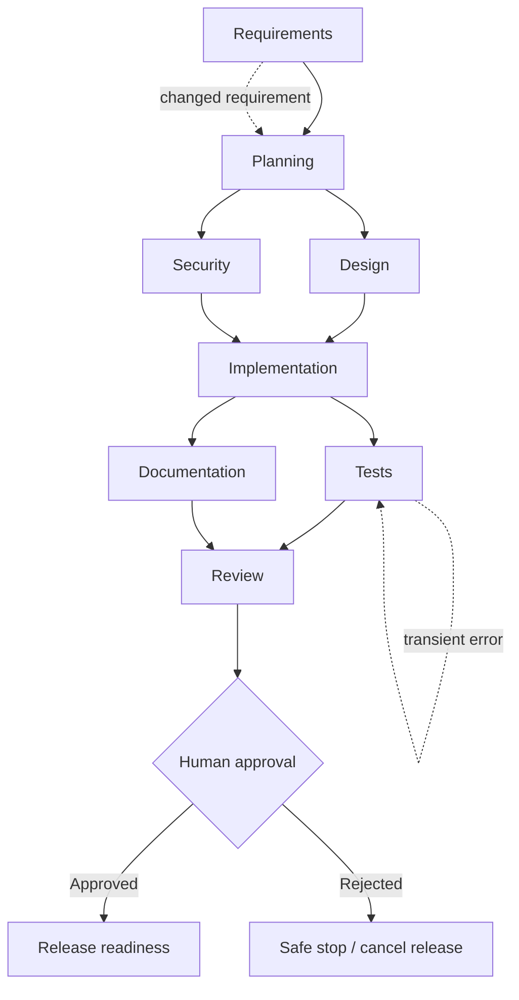

# Agentic URL Shortener — Interview Assignment

A **.NET 8 runnable prototype** combining a URL-shortening service with a stateful, approval-controlled engineering workflow. It is intentionally a **bounded deterministic agent prototype**, not an autonomous LLM code-writing system. Agent outputs are structured, inspectable engineering artifacts; no claims of actual AI code generation or deployment are made.

## Prerequisites
- .NET 8 SDK (`dotnet --version`)
- Git; no database server, cloud account, or API key required

## Run
```bash
dotnet restore tests/AgenticUrlShortener.Tests/AgenticUrlShortener.Tests.csproj
dotnet test tests/AgenticUrlShortener.Tests/AgenticUrlShortener.Tests.csproj
dotnet run --project src/AgenticUrlShortener --urls http://localhost:5080
```
Open http://localhost:5080/docs for a basic endpoint directory. JSON state is saved in `src/AgenticUrlShortener/data/` by default. Set `DATA_DIR` to change the location. For local demonstration only; do not expose publicly without auth and additional protections.

## URL shortening demo
```bash
curl -i -X POST http://localhost:5080/api/urls -H 'Content-Type: application/json' -d '{"url":"https://example.com","expiresInDays":30}'
# Copy the returned 10-character code:
curl -i http://localhost:5080/YOUR_CODE
curl http://localhost:5080/api/urls/YOUR_CODE/analytics
curl -X DELETE http://localhost:5080/api/urls/YOUR_CODE
```

## Agentic workflow demo
```bash
curl -X POST http://localhost:5080/api/workflows -H 'Content-Type: application/json' -d '{"requirement":"Create a URL shortener with analytics","scenario":"greenfield","simulateTestFailure":true}'
# Copy id from JSON. Observe WaitingApproval, DAG node states, retry events and artifacts.
curl http://localhost:5080/api/workflows/YOUR_ID
curl http://localhost:5080/api/workflows/YOUR_ID/audit
curl -X POST http://localhost:5080/api/workflows/YOUR_ID/approval -H 'Content-Type: application/json' -d '{"approved":true,"reviewer":"human-reviewer","reason":"Reviewed test and design evidence"}'
curl http://localhost:5080/api/workflows/metrics
```
**Replan (before approval):**
```bash
curl -X POST http://localhost:5080/api/workflows/YOUR_ID/replan -H 'Content-Type: application/json' -d '{"requirement":"Add URL expiry and click analytics"}'
```
**Reject:** on a fresh waiting workflow, POST `{"approved":false,"reviewer":"human-reviewer","reason":"Risk not accepted"}` to `/api/workflows/YOUR_ID/approval`.

## Agent graph


## What is real vs simulated
- **Real:** HTTP API, persistent links/click counters, unique cryptographic codes, expiration, disable, JSON persistence, DAG scheduler, parallel independent nodes, synchronization gates, named approval, retry on injected failure, rejection/rollback of pending release, replan with invalidation, audit trail and computed metrics.
- **Simulated:** Engineering agents produce deterministic evidence strings and structured requirements, rather than modifying repository files or invoking an LLM. The implementation agent inspects/declares code scope; it does not write source code. The testing agent produces a validation plan and supports an injected transient failure; the real test suite is run separately with `dotnet test`. Release readiness does not deploy.
- **Human control:** No automated production release. Approval is explicit, but **the API has no authentication**, so it is a local demo only.

## Architecture and risks
See [docs/ARCHITECTURE.md](docs/ARCHITECTURE.md), [docs/SCENARIOS.md](docs/SCENARIOS.md), and [docs/ENGINEERING_SUMMARY.md](docs/ENGINEERING_SUMMARY.md).

## GitHub submission
```bash
git init
git add .
git commit -m "Build agentic URL shortener prototype"
git branch -M main
# Create an empty public repository named agentic-url-shortener in your GitHub account.
git remote add origin https://github.com/YOUR_USERNAME/agentic-url-shortener.git
git push -u origin main
```
Share `https://github.com/YOUR_USERNAME/agentic-url-shortener` after the push succeeds. A repository URL shares code, not a hosted running service.
